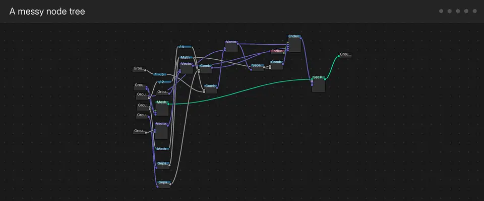

# nodefmt

A formatter for Blender node trees, in the spirit of code formatters such as ruff or black. It
sorts a tree into columns, orders the nodes to remove crossings, lines links up and routes the
rest as orthogonal wires on reroutes. It never changes what the tree computes, and sorting a
sorted tree changes nothing.

The animation shows the steps on a messy tree ([MP4](media/nodefmt-demo.mp4),
[GIF](media/nodefmt-demo.gif)). The same tree in Blender, before and after:
[media/before-after.png](media/before-after.png). The tree is the "Wire" group from
[aoc-2015-blender-gn](https://github.com/carjimcor/aoc-2015-blender-gn), Advent of Code 2015
solved with Geometry Nodes, the project nodefmt was made for.

## What it guarantees

- **Logic never changes**: a sort that would change what the tree computes is undone.
- **No curved wires and nothing behind nodes**: a link that is not straight turns at right
  angles on reroutes, and no wire passes behind a node.
- **Orthogonal at your UI scale**: every drawn segment is exactly horizontal or vertical.
- **Idempotent and deterministic**: the same tree always gives the same layout.

## Install

Blender 5.2 or newer. Download `nodefmt-0.7.0.zip` from the
[releases](https://github.com/carjimcor/blender-nodefmt/releases) (or build it with
`tools/build.sh`), then in Blender: Edit > Preferences > Get Extensions > the arrow menu > Install
from Disk.

## Quick use

In a Geometry Nodes, Shader or Compositor editor, open the sidebar (N) and the nodefmt tab:

- **Sort Current Tree**: the tree shown in the editor.
- **Sort Selection**: only the selected nodes, or what is inside a selected frame.
- **Sort All Trees**: every node tree in the file.
- **Check Current Tree**: the rules the tree breaks, without changing it.

A sort shows its progress and Esc cancels it. Each sort is one undo step: Ctrl+Z puts the tree
back.

## Documentation

- [Usage](docs/USAGE.md): the panel, buttons, modes, rule toggles and Check.
- [Rules](docs/RULES.md): every rule with its code, an example and how to switch it off.
- [Configuration](docs/CONFIGURATION.md): `nodefmt.toml`.
- [Command line](docs/CLI.md): `--check`, `--fix` and the git pre-commit hook.
- [Limitations](docs/LIMITATIONS.md)
- [How it works](docs/ALGORITHM.md): the layout pipeline and its references.

## Contributing

Contributions are welcome; reviews may take a while. A pull request that changes a layout must
show it with before and after screenshots. See [CONTRIBUTING.md](CONTRIBUTING.md), which also
explains how to run the tests.

## AI use

This add-on is vibe coded: all of its code, documentation, tools and the demo animation were
written by AI ([Claude Code](https://claude.com/claude-code)). My part was the idea, the style
rules, reviewing the results in Blender and deciding what to change.

## Credits and license

`nodefmt/sockets.py` is adapted from [Node Arrange](https://extensions.blender.org/add-ons/node-arrange/)
1.12.1, licensed GPL-2.0-or-later; its notice is kept in the file.

nodefmt is licensed under the GNU General Public License v3.0 or later ([LICENSE](LICENSE)).
