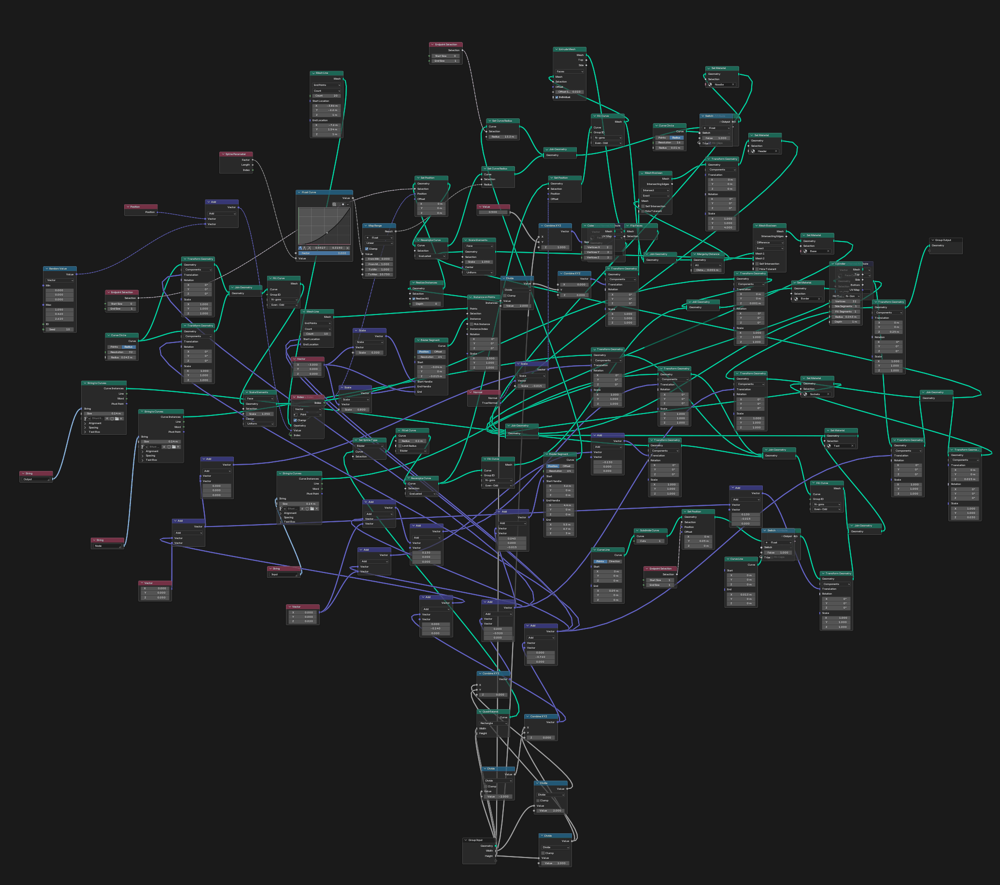
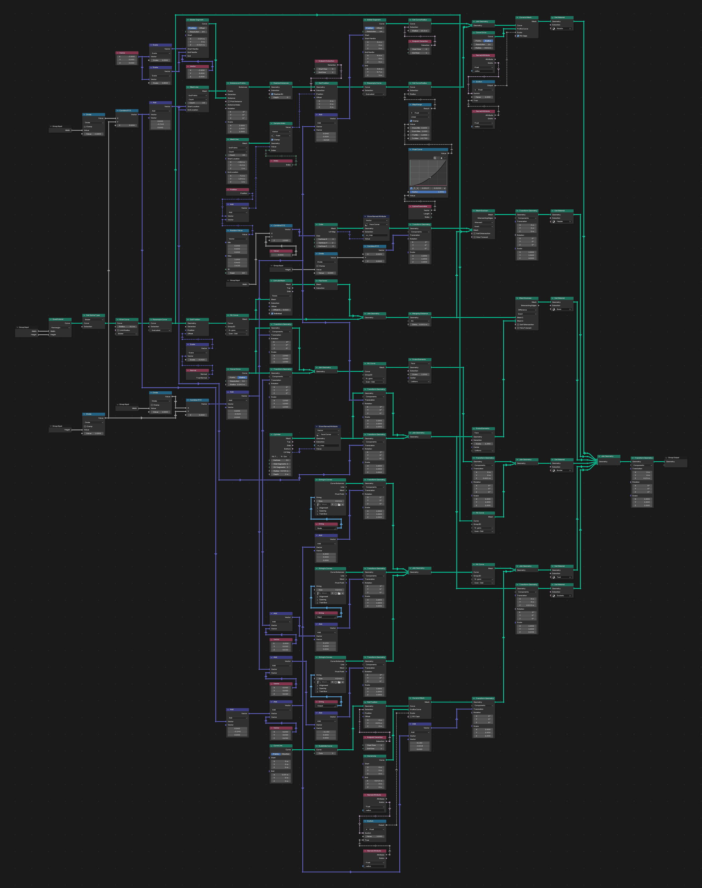

# A large real tree

The node tree from the Blender Stack Exchange question
[How can I better structure my node tree and make it easier for others to understand?](https://blender.stackexchange.com/questions/266334/how-can-i-better-structure-my-node-tree-and-make-it-easier-for-others-to-underst)
by [quellenform](https://blender.stackexchange.com/users/145249/quellenform): a deliberately
tangled Geometry Nodes tree ("GN.Psychologist" in its .blend file), whose answers collect advice
on readable node trees.

The tree has 115 nodes. It was opened in Blender 5.2 and sorted with Sort Current Tree, all rules
on, at UI scale 1.4; the result has 264 nodes, most of them reroutes and copies of input nodes.
The images were made with an earlier version, where the sort took about five minutes; the
current one sorts it in about half a minute. Both images are captured at half zoom.

## Before

## After

## Credits

The node tree is the work of quellenform, shared on Blender Stack Exchange under
[CC BY-SA 4.0](https://creativecommons.org/licenses/by-sa/4.0/). The two screenshots on this page
show that tree (the second one rearranged by nodefmt) and are shared under the same license.
