# Rules

Every behaviour of nodefmt is a rule with a code, as in ruff. Guarantees (NF001-NF005) always
hold. Style rules can be switched off: with their checkbox in the panel (or in Preferences >
Add-ons > nodefmt), with `ignore = ["NF031"]` in [nodefmt.toml](CONFIGURATION.md), or with
`--ignore NF031` on the [command line](CLI.md). A rule that is off is neither applied when
sorting nor reported by a check. NF022, NF023 and NF035 are off by default: select them by code,
by name or with `"ALL"`.

| Code | Name | Kind | What it does |
|---|---|---|---|
| [NF001](#nf001-no-curved-links) | no-curved-links | guarantee | A link that is not straight turns on reroutes. |
| [NF002](#nf002-no-links-behind-nodes) | no-links-behind-nodes | guarantee | No wire passes behind a node. |
| [NF003](#nf003-orthogonal-segments) | orthogonal-segments | guarantee | Every segment is horizontal or vertical (within half a unit) at the UI scale used. |
| [NF004](#nf004-no-overlapping-reroutes) | no-overlapping-reroutes | guarantee | No two reroutes of different wires closer than 10 units. |
| [NF005](#nf005-logic-unchanged) | logic-unchanged | guarantee | A sort that would change the logic is undone. |
| [NF010](#nf010-duplicate-input-nodes) | duplicate-input-nodes | style | Input-like nodes get a copy next to each distant group of consumers. |
| [NF011](#nf011-commutative-swaps) | commutative-swaps | style | The two inputs of a commutative node may be swapped to remove a crossing. |
| [NF020](#nf020-free-zone-outputs) | free-zone-outputs | style | A zone's output may sit where its inputs are instead of level with the zone input. |
| [NF021](#nf021-blocks-next-to-consumer) | blocks-next-to-consumer | style | A frame or zone with nothing linked into it sits right before the node it feeds; one with nothing linked at all sits compactly under the tree. |
| [NF022](#nf022-converging-shape) | converging-shape | style, off by default | A tree that converges on one output may take a ">" shape. |
| [NF023](#nf023-stacked-fields) | stacked-fields | style, off by default | A short chain of field nodes is stacked above or below the node it feeds, in its column. |
| [NF030](#nf030-staircase-bundles) | staircase-bundles | style | Wires leaving or entering one node are nested like stairs and do not cross. |
| [NF031](#nf031-no-u-jogs) | no-u-jogs | style | No U-jogs, landings or tiny steps that a free height would remove. |
| [NF032](#nf032-wire-clearance) | wire-clearance | style | Wires keep clear of node edges, frame borders and zone outlines. |
| [NF033](#nf033-avoid-crossings) | avoid-crossings | style | A crossing that can be avoided is avoided. |
| [NF034](#nf034-no-junction-look) | no-junction-look | style | Wires never share a point or run on one line. |
| [NF035](#nf035-fanned-multi-inputs) | fanned-multi-inputs | style, off by default | The links into a Join Geometry or Join Strings arrive spread out and converge in a short fan. |
| [NF036](#nf036-shared-tracks) | shared-tracks | style | Vertical runs one above the other in a gap share one x. |
| [NF040](#nf040-label-first-reroute) | label-first-reroute | style | A reroute label goes on the first reroute of its wire. |
| [NF041](#nf041-label-clearance) | label-clearance | style | Reroute labels, and the greyed copies Blender shows, overlap no label, node or wire. |

Check also reports **NF900 not-formatted** when a sort would move anything. NF020, NF022, NF023
and NF036 have no geometric check of their own: a tree that does not follow them is reported as
NF900.

## The examples

Every rule has a small tree in `examples/NF0xx.blend` (one Geometry Nodes group named after the
rule; open the file, switch an editor to the Geometry Node Editor and pick the group). Some rules
have a second example, `examples/NF0xx-<what>.blend`. The images below are made from them:

- **Guarantees**: before, the example as built, which breaks the rule; after, the example sorted
  with no style rules at all.
- **Style rules**: before, the example sorted with every style rule off (the file is saved that
  way); after, sorted with only that rule on. The two differ only by what the rule does.

The images are Blender screenshots at UI scale 1.0 (NF034 at 1.25). Each place that breaks the
rule is ringed in red in the before image, where the check gives a place. `tests/run_tests.py`
tests every example (see [CONTRIBUTING.md](../CONTRIBUTING.md)).

## Guarantees

### NF001 no-curved-links

A link that is not straight turns on reroutes: no link is drawn as a curve or a diagonal.

**Why:** a curve between two columns crosses other wires at odd angles and hides where it goes;
straight runs and right angles read like a circuit diagram.

**Example:** Set Position sits lower than the nodes it connects, so both links curve. After the
sort it is level with them and both links are straight.

With NF035 (off by default), the last stretch of each link into a multi-input socket is a
deliberate diagonal fan, not a fault of NF001 or NF003.

| Before | After |
|---|---|
|  |  |

### NF002 no-links-behind-nodes

No wire passes behind a node.

**Why:** a wire behind a node looks as if it were connected to it, and its own path is hidden.

**Example:** the Value wire runs straight through Transform Geometry. After the sort it goes over
Transform Geometry. It crosses the Geometry wire twice on the way: avoiding that is NF033, off
here.

| Before | After |
|---|---|
|  |  |

### NF003 orthogonal-segments

Every drawn wire segment is exactly horizontal or vertical (within half a unit) at the UI scale
the tree is sorted for.

**Why:** a segment one or two units off is drawn as a slightly slanted, jagged line. Blender
rounds node positions and socket offsets to pixels, so this happens easily at a fractional UI
scale; the sort reads back what Blender draws and straightens what rounding left (see
[How it works](ALGORITHM.md#orthogonal-wires)).

**Example:** a reroute 1.5 units above the line of its wire. After the sort the link is straight.

| Before | After |
|---|---|
|  |  |

**Second example** (`NF003-rows`, at UI scale 1.4): Blender draws the rows of a node a pixel
taller above y = 0 than below it, so a tall node is several units taller above 0. Measured below
0 but drawn above it, the Scale input of this tall Instance on Points was 4 units lower than
measured, and the wire from Multiply got a step too small to see (two reroutes on one spot that
look like a slanted stub). The sort measures every node below 0 and puts the whole tree below 0,
so the wire is straight. The test also checks that no wire is left with such a step.

| Before | After |
|---|---|
| 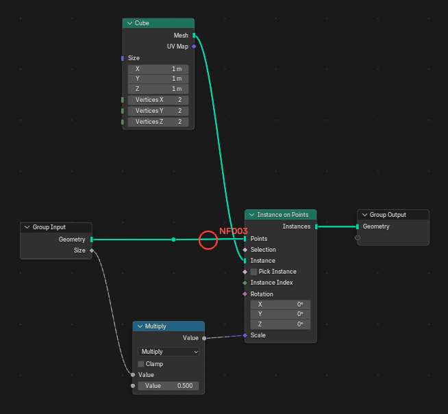 | 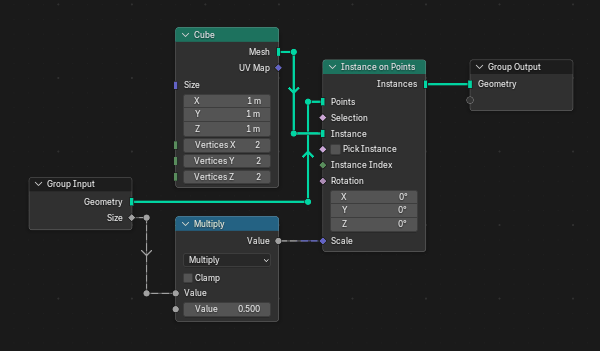 |

### NF004 no-overlapping-reroutes

No two reroutes of different wires sit on top of each other (closer than 10 units).

**Why:** two reroutes on one spot look like one, as if the wires were joined.

**Example:** two crossing wires turn 4 units apart. After the sort each wire turns at its own
place. The wires still cross: Combine XYZ cannot swap its inputs, and copying the Group Input is
NF010, off here.

| Before | After |
|---|---|
|  |  |

### NF005 logic-unchanged

Sorting never changes what the tree computes. Before a sort nodefmt takes a logic fingerprint of
the tree: node types, properties and socket values (hidden ones too), parents, zone pairs, the
group interface, and every link resolved through reroutes, with the order of multi-input links.
Copies of input-like nodes count as one source, and the two inputs of a commutative node as a
pair. If the fingerprint differs after the sort, the tree is restored and the sort reports an
error.

**Example:** a messy tree, with nodes out of order and links that curve and cross. After the sort
the layout is new and the logic fingerprint is the same: each image shows the first 12 hex digits
of a hash of the fingerprint, under the tree.

| Before | After |
|---|---|
| 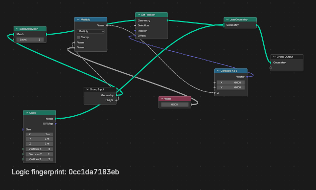 | 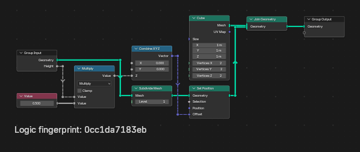 |

## Style rules

### NF010 duplicate-input-nodes

Input-like nodes (Group Input, Named Attribute, Position, constants, ...) get a copy next to each
distant group of consumers instead of long wires from one node. Never copied: String nodes,
labelled nodes, and nodes that load data (Image Texture, Render Layers, ...).

**Why:** a long wire across the tree is hard to follow and crosses everything on its way; a copy
next to the consumer says the same thing locally.

**Example:** the Scale input of the Group Input runs under the whole tree to Transform Geometry.
With the rule, Transform Geometry gets its own Group Input.

**Off:** the tree keeps one Group Input and the long wire.

| Before | After |
|---|---|
|  |  |

### NF011 commutative-swaps

The two inputs of a commutative node (Add, Multiply, Minimum, Maximum, AND, OR, XOR, Equal, Not
Equal, Add Shader) may be swapped when that removes a crossing.

**Why:** a + b is b + a, so the crossing is free to remove.

**Example:** X goes to the lower input of Add and Y to the upper one, so the wires cross; Separate
XYZ cannot change the order of its outputs. With the rule the inputs are swapped and the wires are
straight.

**Off:** the links keep their inputs and the crossing stays.

| Before | After |
|---|---|
|  |  |

A frame or zone is laid out before what is around it, so it cannot see where its incoming wires
come from. When a swap inside it only exchanges two of its ports, the swap is left to the level
around the block, which sees both wires.

**Second example** (`NF011-frame`): Zeta and Alpha come in the order of the Group Input's sockets
and feed the Add in frame "Sum", Alpha the upper input, so the wires cross at the frame's left
side. With the rule the Add's inputs are swapped and nothing crosses.

| Before | After |
|---|---|
| 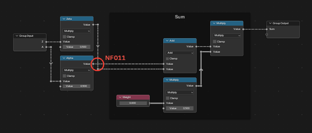 | 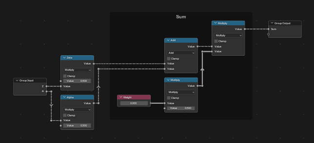 |

**Third example** (`NF011-zone`): the same in a frame inside a Repeat zone, where the Add gets the
doubled iteration from inside the zone and Alpha from outside it. The zone sees both wires and
makes the swap.

| Before | After |
|---|---|
| 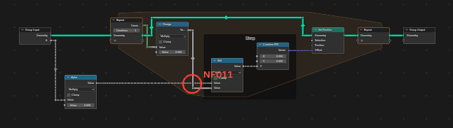 | 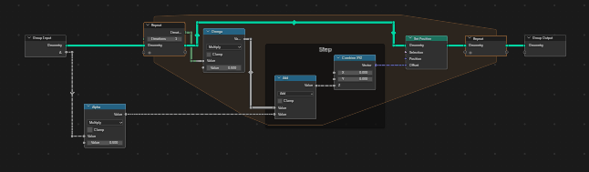 |

### NF020 free-zone-outputs

A zone's output may sit where its inputs are instead of level with the zone input.

**Why:** the wires into the zone output can then be straight, at the price of a zone that is not
rectangular.

**Example:** with the Repeat output level with the Repeat input, Instance on Points sits lower and
the wire into its Points input steps down. With the rule the zone output is 25 units higher,
Instance on Points rises with it, and the wires from the Repeat input and into the Repeat output
are straight.

**Off:** the zone output stays level with the zone input (its item sockets on one line).

| Before | After |
|---|---|
|  |  |

### NF021 blocks-next-to-consumer

A frame or zone with nothing linked into it sits in the column right before the node it feeds,
above or below the main flow, instead of at the far left. One with nothing linked at all (notes,
a test, a block nothing uses yet) sits under the tree where it makes the tree grow least.

**Why:** a self-contained block (a frame that builds an instance, a constant) belongs to where it
is used; at the far left it needs a wire across the whole tree.

**Example:** the "Cube" frame feeds Instance on Points at the end of the tree. With the rule it
sits right before Instance on Points, below the main row.

**Off:** the frame takes the first columns, far from its consumer, and blocks with nothing linked
go in a row under the tree, from its left edge.

| Before | After |
|---|---|
|  |  |

**Second example** (`NF021-alone`): frame "Cube" feeds Instance on Points late in a long row, and
frame "Test" is linked to nothing. Without the rule "Test" is put under the left end of the tree;
with it, "Cube" sits under the end of the row and "Test" beside it, under the start of the row.
Check reports a frame with nothing linked that could sit more than 100 units higher.

| Before | After |
|---|---|
| 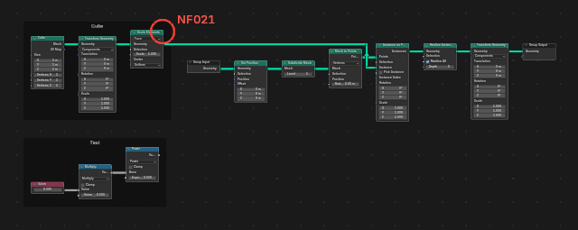 | 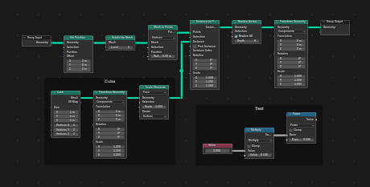 |

### NF022 converging-shape

Off by default. A tree that converges on one output may take a ">" shape, with the output in the
middle of its inputs, instead of everything hanging from a common top line. The sort tries this
placement next to the others and keeps it only when it costs less.

**Why:** in trees where branches of different lengths share inputs, the ">" shape is lower and
has fewer bends. It is off by default because on the test trees it left more crossings than the
layouts without it. In a plain tree of Math nodes the result is the same with the rule on and off.

**Example:** a short branch (one Subtract) and a long one (three Subtracts) converge on a Divide;
both use the two group inputs. Without the rule, Divide and the output hang from the top line and
the long branch climbs up to them like a staircase. With it, Divide sits between its two inputs,
and the tree is lower.

**Off:** the ">" placement is not tried.

| Before | After |
|---|---|
| 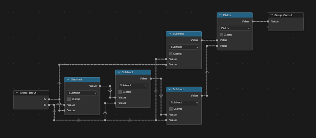 | 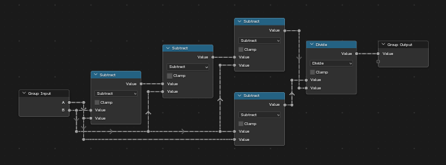 |

### NF023 stacked-fields

Off by default. A short chain of field nodes that feeds one input of a node and nothing else sits
in that node's column, stacked right above or below it, instead of in the columns before it.

**Why:** small field chains (Index -> Compare into a Selection, Position into a Sample Index) are
read as part of the node they feed. In columns of their own they push the tree apart, and a chain
that ends inside a zone gets wires across the whole zone.

A chain is up to three nodes linked one after the other, the first with nothing linked in, each
with a single link out, all in the consumer's frame; no geometry sockets, zones, outputs, reroutes
or Group Inputs. A node takes at most two chains: the one into its highest input goes above, the
one into its lowest goes below. A single chain goes on the side where it crosses fewer of the
node's other links.

**Example:** Index -> Equal feeds the Selection of Store Named Attribute, and Position -> Length
its Value. Without the rule both chains take the columns before Store Named Attribute. With it,
Index and Equal sit above it and Length and Position below it.

**Off:** chains are laid out like any other node.

| Before | After |
|---|---|
| 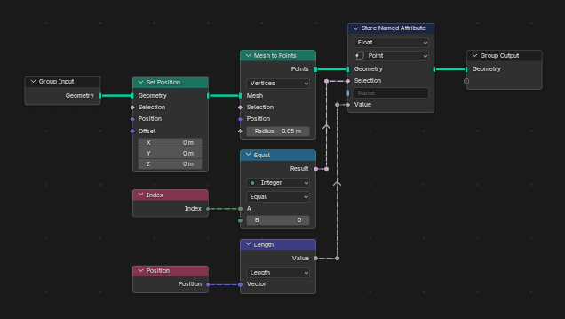 | 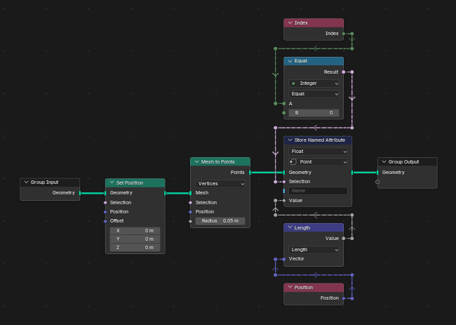 |

### NF030 staircase-bundles

Wires that leave one node or enter one node are nested like stairs and never cross each other.

**Why:** wires of one node that cross each other are the hardest to follow, since they start or
end side by side.

**Example:** Combine XYZ and Separate XYZ both feed the Group Output, Combine XYZ the upper
socket. Without the rule Combine XYZ sits lower, so the wire from Separate XYZ comes down across
it just before the Group Output. With the rule Combine XYZ sits on top and the wires do not cross.

**Off:** crossings inside a bundle cost as much as any other crossing.

| Before | After |
|---|---|
|  |  |

### NF031 no-u-jogs

A route does not reverse its vertical direction unless a node is in the way, has no landing that
could merge with the level before or after it, and no step so small that its two reroutes sit on
one spot.

**Why:** a wire that climbs over nothing and comes back down looks like it avoids something that
is not there.

**Example:** without the rule the Height wire climbs over Separate XYZ and comes all the way back
down to Combine XYZ. With it, the wire goes down at once and runs below the other wires.

**Off:** the final pass over the drawing no longer moves runs to remove U-jogs and landings.

| Before | After |
|---|---|
|  |  |

### NF032 wire-clearance

Wires keep clear of node edges, frame borders and zone outlines: no wire runs along them.

**Why:** a wire along an edge merges with it and looks like part of the node or the frame.

**Example:** the Offset wire enters a Repeat zone to the Add inside it. Without the rule it runs
along the bottom of the zone's outline; with it, the wire keeps clear of the outline.

**Off:** lanes in a zone keep the usual gap from the nodes (20 units instead of 34), and runs
along edges and outlines cost nothing.

| Before | After |
|---|---|
|  |  |

### NF033 avoid-crossings

A crossing that can be avoided (a lane on the other side, a wire entering a zone above its input)
is avoided.

**Why:** every crossing is a place where the eye can take the wrong wire.

**Example:** without the rule the Value wire goes over Transform Geometry and crosses the Geometry
wire twice. With it, the wire runs under Transform Geometry and crosses nothing.

**Off:** a crossing costs little more than a bend, and lanes keep to one side.

| Before | After |
|---|---|
|  |  |

### NF034 no-junction-look

Different wires never share a point or run on one line, and no reroute sits in the middle of a
straight run: nothing looks like a junction.

**Why:** a dot on a straight wire, or two wires on one line, read as a junction where wires meet.

**Example** (at UI scale 1.25, which the example stores; at 1.0 nothing is rounded and this does
not happen in a tree this small): rounding to the pixel grid leaves a reroute in the middle of the
straight Z wire into Subtract, just before it crosses the Vector wire. With the rule the run is
made level and the reroute is gone.

**Off:** almost level runs are not made level, reroutes left in straight runs stay, and wires on
one line or reroutes on another wire cost nothing.

| Before | After |
|---|---|
|  |  |

### NF035 fanned-multi-inputs

Off by default. The links into a multi-input socket (Join Geometry, Join Strings, Mesh Boolean,
...) arrive a widget unit (20 units) apart and converge in a short fan right before the socket,
instead of running a quarter widget unit (5 units) apart from the gap before the node.

**Why:** the order of the links into a Join Geometry or Join Strings matters, and 5 units apart
their wires blur into one thick band. Spread out, each wire can be followed to its slot.

Each link runs to its fan point, a reroute about 30 units left of the socket (more for a big
fan), and from there diagonally to its slot; with Blender's noodle curving the diagonal is drawn
as a small curve. The fan keeps clear of the wires into the node's other inputs (the Delimiter of
a Join Strings), moving away from them and, if needed, spreading less (never under 10 units). A
collapsed node has no fan. Check reports a multi-input socket whose links arrive less than 10
units apart.

**Example:** three Grids feed one Join Geometry. Without the rule their wires turn into the
socket 5 units apart; with it they arrive 20 units apart and converge in the last 30 units. The
second example (`NF035-strings`) is a Join Strings whose Delimiter is linked too: the fan of its
three Strings moves down, clear of the Delimiter wire.

**Off:** the links run to their slots, 5 units apart.

| Before | After |
|---|---|
| 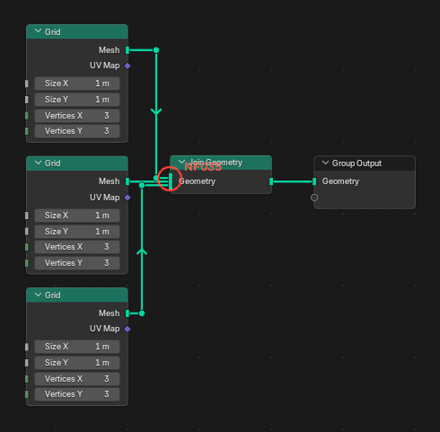 | 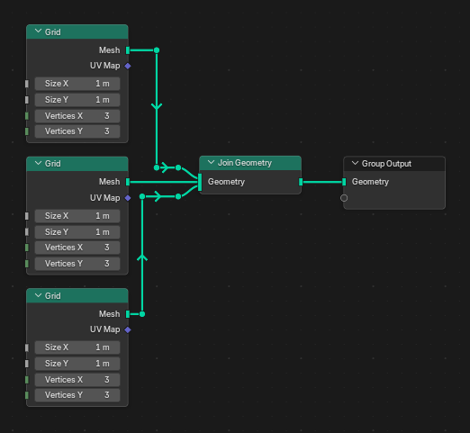 |
| 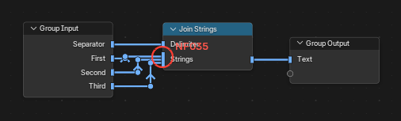 | 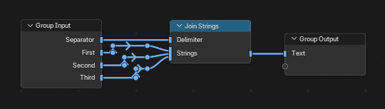 |

### NF036 shared-tracks

Vertical runs in one gap between columns that lie one above the other share one x, instead of
each taking a track of its own. Tracks that overlap in height keep their order, so no crossing
changes.

**Why:** wires that turn in the same gap at different heights do not meet, but on tracks of their
own they form a staircase that looks busier than it is and makes the gap wider. On one line they
read as a few clean turns.

**Example:** three Combine XYZ, each fed Y by a Math node a little lower. Without the rule the
three Y wires turn on three tracks, a staircase. With it they turn on one line and the gap is
narrower.

**Off:** every track of a gap has its own x.

| Before | After |
|---|---|
| 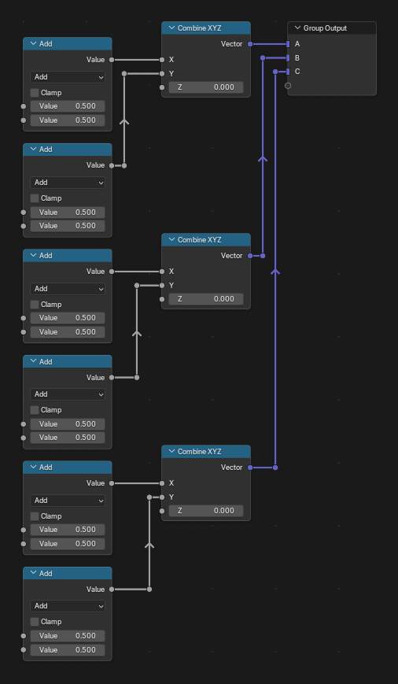 | 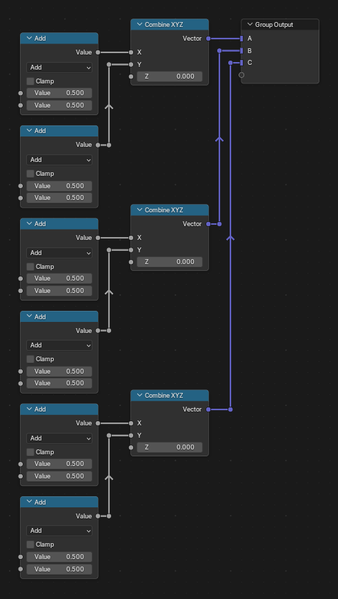 |

### NF040 label-first-reroute

The label of a labelled reroute goes on the first reroute of its wire, near the source.

**Why:** Blender 5 shows a reroute's label, greyed, on every reroute after it on the same wire,
so one label at the start names the whole wire.

**Example:** without the rule the label "Offset" stays on the reroute nearest to where it was,
the second reroute of the Value wire. With it, the label is on the first.

**Off:** the label goes on the reroute nearest to where it was.

| Before | After |
|---|---|
|  |  |

### NF041 label-clearance

A reroute label overlaps no other label, no node and no wire, and neither do the greyed copies of
it that Blender 5 shows above every later reroute of its wire.

**Why:** a label covered by a node or another label, or labels stacked near the sockets of a
node, cannot be read.

The sort measures each label's text as Blender draws it. Gaps between columns widen where a
labelled wire turns next to a node, and the label goes on the first reroute where its text is
clear, or on a new reroute before it (with this rule, NF040 accepts that). A wire that turns
upwards runs through the greyed copy at that turn; that is not counted, since Blender draws the
copy on every reroute.

**Example:** the Offset wire carries the label "Offset along the normal" and turns right before
Set Position, in a narrow gap: the label and its greyed copy on the second turn cover the nodes
on both sides. With the rule the gap widens and both are clear of the nodes and the other wire.

**Off:** gaps do not widen for labels, overlaps of labels cost nothing, and a label goes on the
first reroute whose text overlaps no other label.

| Before | After |
|---|---|
| 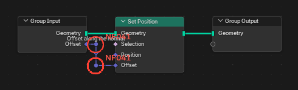 | 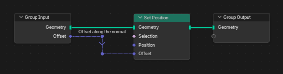 |
