# Rules

Every behaviour of nodefmt is a rule with a code, as in ruff. Guarantees (NF001-NF005) always
hold. Style rules can be switched off: with their checkbox in the panel (or in Preferences >
Add-ons > nodefmt), with `ignore = ["NF031"]` in [nodefmt.toml](CONFIGURATION.md), or with
`--ignore NF031` on the [command line](CLI.md). A rule that is off is neither applied when
sorting nor reported by a check.

| Code | Name | Kind | What it does |
|---|---|---|---|
| [NF001](#nf001-no-curved-links) | no-curved-links | guarantee | A link that is not straight turns on reroutes. |
| [NF002](#nf002-no-links-behind-nodes) | no-links-behind-nodes | guarantee | No wire passes behind a node. |
| [NF003](#nf003-orthogonal-segments) | orthogonal-segments | guarantee | Every segment is horizontal or vertical (within half a unit) at the UI scale used. |
| [NF004](#nf004-no-overlapping-reroutes) | no-overlapping-reroutes | guarantee | No two reroutes of different wires closer than 10 units. |
| [NF005](#nf005-logic-unchanged) | logic-unchanged | guarantee | A sort that would change the logic is undone. |
| [NF010](#nf010-duplicate-input-nodes) | duplicate-input-nodes | style | Input-like nodes get a copy next to each distant group of consumers. |
| [NF011](#nf011-commutative-swaps) | commutative-swaps | style | The two inputs of a commutative node may be swapped to remove a crossing. |
| [NF020](#nf020-free-zone-outputs) | free-zone-outputs | style | A zone's output may sit where its inputs are instead of level with the zone input. |
| [NF021](#nf021-blocks-next-to-consumer) | blocks-next-to-consumer | style | A frame or zone with nothing linked into it sits right before the node it feeds. |
| [NF022](#nf022-converging-shape) | converging-shape | style | A tree that converges on one output may take a ">" shape. |
| [NF030](#nf030-staircase-bundles) | staircase-bundles | style | Wires leaving or entering one node are nested like stairs and do not cross. |
| [NF031](#nf031-no-u-jogs) | no-u-jogs | style | No U-jogs, landings or tiny steps that a free height would remove. |
| [NF032](#nf032-wire-clearance) | wire-clearance | style | Wires keep clear of node edges, frame borders and zone outlines. |
| [NF033](#nf033-avoid-crossings) | avoid-crossings | style | A crossing that can be avoided is avoided. |
| [NF034](#nf034-no-junction-look) | no-junction-look | style | Wires never share a point or run on one line. |
| [NF040](#nf040-label-first-reroute) | label-first-reroute | style | A reroute label goes on the first reroute of its wire. |

Check also reports **NF900 not-formatted** when a sort would move anything.

## The examples

Each rule that can be shown has a small synthetic tree that breaks it, in
`examples/NF0xx.blend` (one Geometry Nodes group, "NF0xx" plus the rule name; open the file,
switch an editor to Geometry Node Editor and pick the group). The images below are Blender
screenshots at UI scale 1.0: before, with each place that breaks the rule ringed in red, and
after a sort with the default rules. `tests/run_tests.py` checks every example (see
[CONTRIBUTING.md](../CONTRIBUTING.md)); `tools/make_examples.py` rebuilds them and
`tools/capture_examples.py` the images.

## Guarantees

### NF001 no-curved-links

Guarantee. A link that is not straight turns on reroutes: no link is drawn as a curve or a
diagonal.

Why: a curve between two columns crosses other wires at odd angles and hides where it goes;
straight runs and right angles read like a circuit diagram.

Example: Set Position sits lower than the nodes it connects, so both links curve. After the sort
it is level with them and both links are straight.

| Before | After |
|---|---|
| 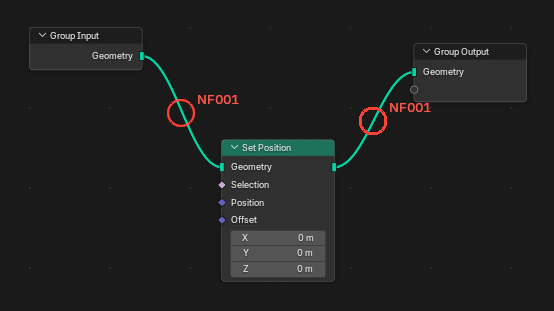 | 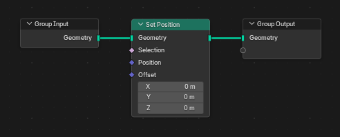 |

### NF002 no-links-behind-nodes

Guarantee. No wire passes behind a node.

Why: a wire behind a node looks as if it were connected to it, and its own path is hidden.

Example: the Value wire runs straight through Transform Geometry. After the sort the Group Input
has a copy next to Set Position (NF010) and the wire goes around.

| Before | After |
|---|---|
| 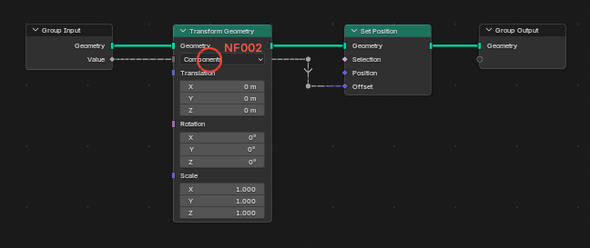 | 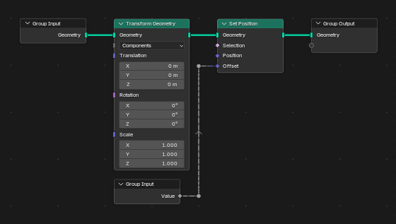 |

### NF003 orthogonal-segments

Guarantee. Every drawn wire segment is exactly horizontal or vertical (within half a unit) at
the UI scale the tree is sorted for.

Why: a segment one or two units off is drawn as a slightly slanted, jagged line. Blender rounds
node positions and socket offsets to pixels, so this happens easily at a fractional UI scale;
the sort reads back what Blender draws and straightens what rounding left (see
[How it works](ALGORITHM.md#orthogonal-wires)).

Example: a reroute 1.5 units above the line of its wire. After the sort the link is straight.

| Before | After |
|---|---|
| 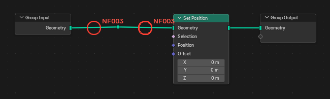 | 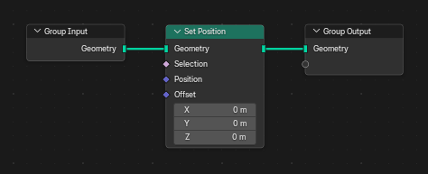 |

### NF004 no-overlapping-reroutes

Guarantee. No two reroutes of different wires sit on top of each other (closer than 10 units).

Why: two reroutes on one spot look like one, as if the wires were joined.

Example: two crossing wires turn 4 units apart. After the sort each wire has its own Group Input
copy (NF010) and no reroutes share a spot.

| Before | After |
|---|---|
| 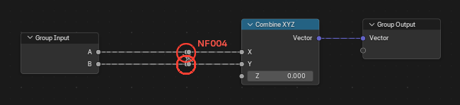 | 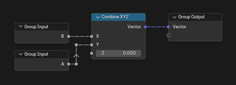 |

### NF005 logic-unchanged

Guarantee. Sorting never changes what the tree computes. Before a sort nodefmt takes a logic
fingerprint of the tree: node types, properties and socket values (hidden ones too), parents,
zone pairs, the group interface, and every link resolved through reroutes, with the order of
multi-input links. Copies of input-like nodes count as one source and the two inputs of a
commutative node as a pair. After the sort the fingerprint is taken again; if anything differs
the tree is restored and the sort reports an error.

There is no example: a tree cannot break this rule, only a sort could. The tests check it on
every example.

## Style rules

### NF010 duplicate-input-nodes

Style. Input-like nodes (Group Input, Named Attribute, Position, constants, ...) get a copy next
to each distant group of consumers instead of long wires from one node. Never copied: String
nodes, labelled nodes, and nodes that load data (Image Texture, Render Layers, ...).

Why: a long wire across the tree is hard to follow and crosses everything on its way; a copy
next to the consumer says the same thing locally.

Example: the Scale input of the Group Input runs under the whole tree to Transform Geometry.
After the sort Transform Geometry has its own Group Input.

Off: the tree keeps one Group Input and the long wire.

| Before | After |
|---|---|
| 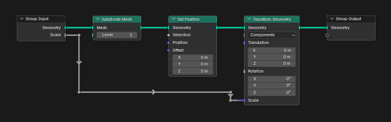 | 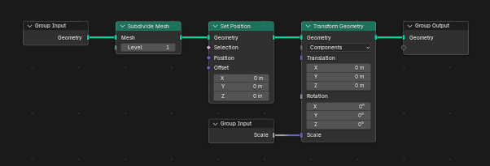 |

### NF011 commutative-swaps

Style. The two inputs of a commutative node (Add, Multiply, Minimum, Maximum, AND, OR, XOR,
Equal, Not Equal, Add Shader) may be swapped when that removes a crossing.

Why: a + b is b + a, so the crossing is free to remove.

Example: X goes to the lower input of Add and Y to the upper one, so the wires cross; Separate
XYZ cannot change the order of its outputs. After the sort the inputs are swapped and the wires
are straight.

Off: the links keep their inputs and the crossing stays.

| Before | After |
|---|---|
| 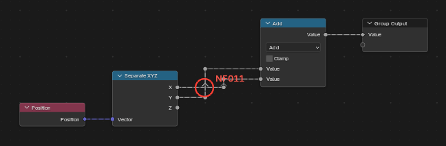 | 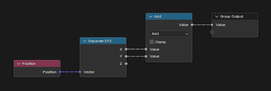 |

### NF020 free-zone-outputs

Style. A zone's output may sit where its inputs are instead of level with the zone input.

Why: the wires into the zone output can then be straight, at the price of a zone that is not
rectangular.

Example: the Repeat output is level with the Repeat input, so the wire from Instance on Points
steps down into it. After the sort the output is 25 units higher and the wire is straight.

Off: the zone output stays level with the zone input (its item sockets on one line).

This rule has no geometric check of its own: Check reports such a tree as not formatted (NF900).

| Before | After |
|---|---|
| 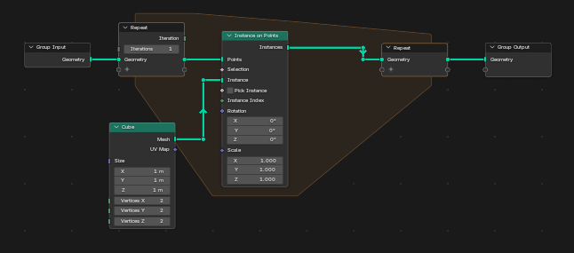 | 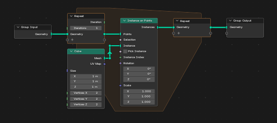 |

### NF021 blocks-next-to-consumer

Style. A frame or zone with nothing linked into it sits in the column right before the node it
feeds, above or below the main flow, instead of at the far left.

Why: a self-contained block (a frame that builds an instance, a constant) belongs to where it is
used; at the far left it needs a wire across the whole tree.

Example: the "Cube" frame sits under the start of the tree and feeds Instance on Points at the
end. After the sort it sits right before Instance on Points.

Off: the frame takes the first columns, far from its consumer.

| Before | After |
|---|---|
| 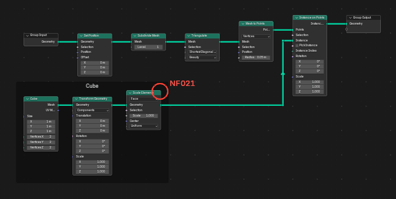 | 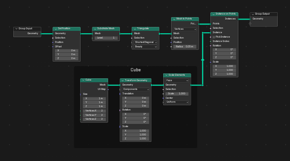 |

### NF022 converging-shape

Style. A tree that converges on one output may take a ">" shape, with the output in the middle
of its inputs, instead of everything hanging from a common top line.

The sort tries this placement next to the others and keeps it only when it costs less (fewer
bends, shorter wires). On small trees it rarely does, so there is no example: on the synthetic
converging trees tried for this page (chains into a Join Geometry, trees of Math nodes) the
result was the same with the rule on and off.

Off: the ">" placement is not tried.

### NF030 staircase-bundles

Style. Wires that leave one node or enter one node are nested like stairs and never cross each
other.

Why: wires of one node that cross each other are the hardest to follow, since they start or
end side by side.

Example: X, Y and Z of Separate XYZ go to three Multiply nodes in the wrong order, so the wires
cross on both sides. After the sort the Multiply nodes are in order and no wires cross.

Off: crossings inside a bundle cost as much as any other crossing. This example sorts the same
either way; the rule matters in larger trees, where a crossing has to go somewhere.

| Before | After |
|---|---|
| 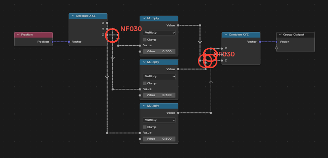 | 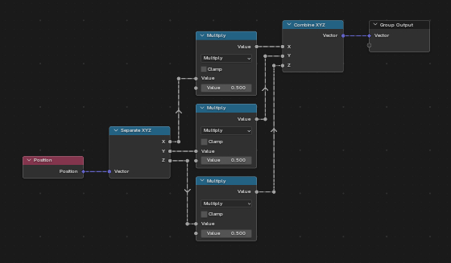 |

### NF031 no-u-jogs

Style. A route does not reverse its vertical direction unless a node is in the way, has no
landing that could merge with the level before or after it, and no step so small that its two
reroutes sit on one spot.

Why: a wire that climbs over nothing and comes back down looks like it avoids something that is
not there.

Example: the Geometry wire climbs 80 units and comes back down. After the sort it is straight.

Off: the final pass over the drawing no longer moves runs to remove U-jogs and landings. This
example sorts the same either way, since the new layout has no jog to remove.

| Before | After |
|---|---|
| 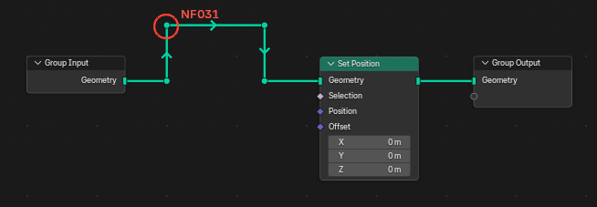 | 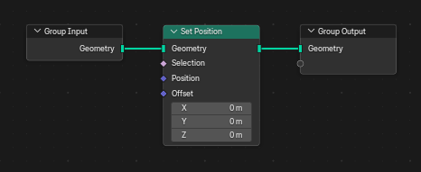 |

### NF032 wire-clearance

Style. Wires keep clear of node edges, frame borders and zone outlines (no wire runs along
them).

Why: a wire along an edge merges with it and looks like part of the node or the frame.

Example: the Value wire runs 6 units under the bottom edge of Transform Geometry. After the sort
it comes from a Group Input copy below Transform, clear of its edge.

Off: wires may run close to edges (the layout no longer pays for it). This example sorts the
same either way.

| Before | After |
|---|---|
| 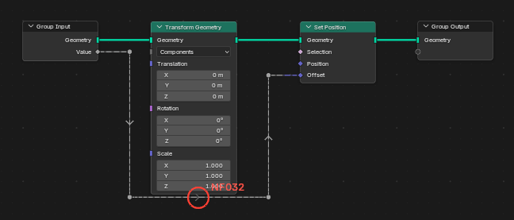 | 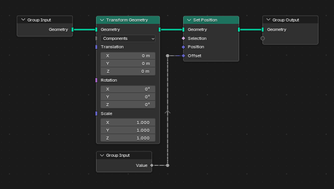 |

### NF033 avoid-crossings

Style. A crossing that can be avoided (a lane on the other side, a wire entering a zone above its
input) is avoided.

Why: every crossing is a place where the eye can take the wrong wire.

Example: the Value wire goes over the Geometry wire and crosses it twice; under Transform it
would not cross at all. After the sort it runs under Transform.

Off: a crossing costs little more than a bend and lanes keep to one side. This example sorts the
same either way.

| Before | After |
|---|---|
| 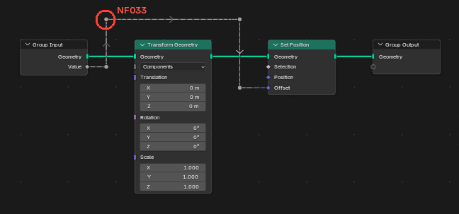 | 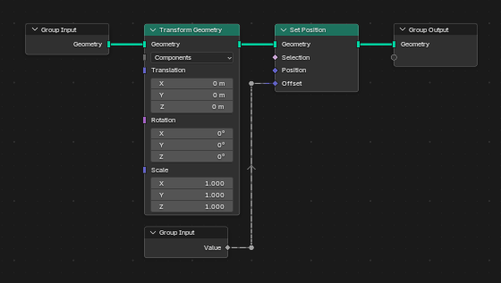 |

### NF034 no-junction-look

Style. Different wires never share a point or run on one line, and no reroute sits in the middle
of a straight run: nothing looks like a junction.

Why: a dot on a straight wire, or two wires on one line, read as a junction where wires meet.

Example: a reroute in the middle of the straight Geometry wire. After the sort it is gone.

Off: almost level runs are not made level and leftover reroutes in straight runs stay. This
example sorts the same either way.

| Before | After |
|---|---|
| 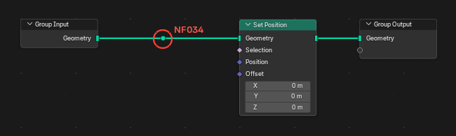 | 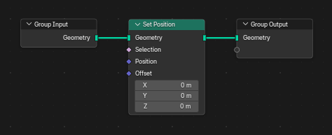 |

### NF040 label-first-reroute

Style. The label of a labelled reroute goes on the first reroute of its wire, near the source.

Why: Blender 5 shows a reroute's label, greyed, on every reroute after it on the same wire, so
one label at the start names the whole wire.

Example: the label "Offset" is on the second reroute of the Value wire. After the sort it is on
the first.

Off: the label goes on the reroute nearest to where it was.

| Before | After |
|---|---|
| 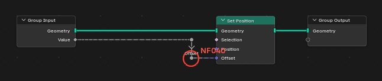 | 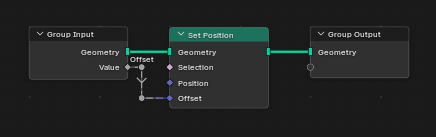 |
