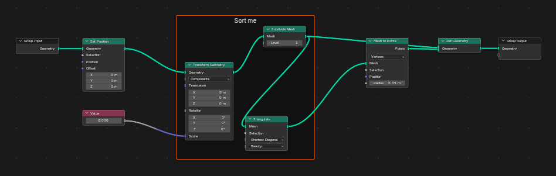
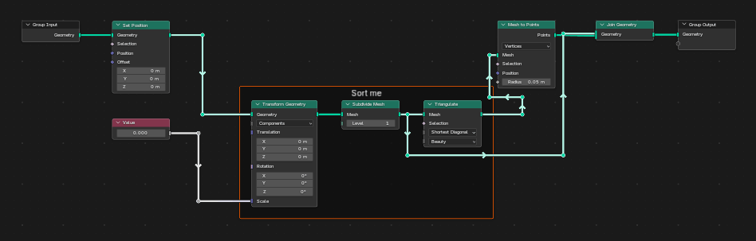
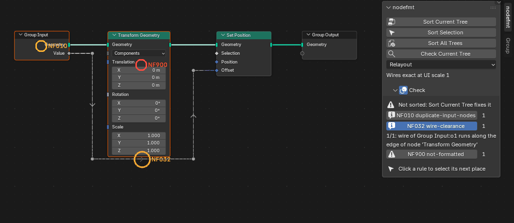
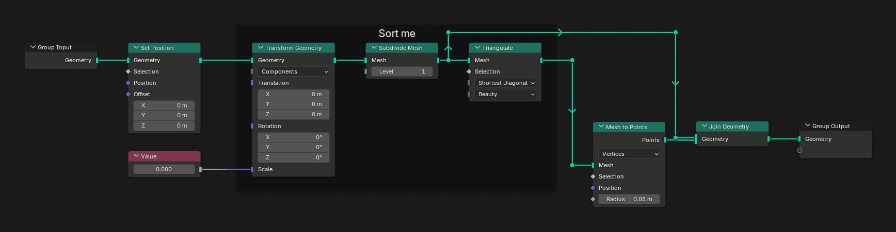

# Usage

## Install

Blender 5.2 or newer.

1. Download `nodefmt-0.10.0.zip` from the [releases](https://github.com/carjimcor/blender-nodefmt/releases),
   or build it with `tools/build.sh`.
2. In Blender: Edit > Preferences > Get Extensions > the arrow menu > Install from Disk, and pick
   `nodefmt-0.10.0.zip`. It is enabled on install.

## Supported editors

- Geometry Nodes: every node group.
- Shader: materials, worlds, lights and shader node groups.
- Compositor: the scene's compositor and compositor groups.

Zones (Repeat, Simulation, For Each Element, Closure) and frames work in every editor.

## The panel

In a node editor, open the sidebar (N) and the nodefmt tab.

- **Sort Current Tree**: sorts the tree shown in the editor.
- **Sort Selection**: sorts only the selected nodes and reroutes, or what is inside a selected
  frame; the rest of the tree stays where it is (see [below](#sort-selection)).
- **Sort All Trees**: sorts every node tree in the file (Geometry Nodes groups, materials,
  worlds, lights and the compositor). A tree that cannot be sorted without changing its logic is
  left as it was and reported.
- **Check Current Tree**: finds the rules the tree breaks, without changing it. The result
  appears in the Check section below the buttons and as marks in the editor (see
  [Check](#check)).
- **Mode**:
  - *Relayout* (default): builds a new layout from scratch: columns, order and wires.
  - *Keep layout (experimental)*: keeps your columns and order and only straightens wires and
    fixes reroutes.
- **Wires exact at UI scale**: the Resolution Scale the wires are made exact for (see
  [Limitations](LIMITATIONS.md)).
- **Check**: the result of the last check (see [Check](#check)).
- **Capture**: Capture Tree saves an image of the tree and its options (see
  [Capture](#capture)).
- **Rules** (closed at first): one checkbox per style rule (see [Rules](RULES.md)) and "Use
  nodefmt.toml". The same options are in Preferences > Add-ons > nodefmt. While "Use nodefmt.toml" is on and a
  `nodefmt.toml` is found next to the .blend file or above it, the file wins over the checkboxes
  and the panel shows its name (see [Configuration](CONFIGURATION.md)).

Each sort is one undo step: Ctrl+Z puts the tree back. At a fractional UI scale (1.25, 1.4, ...)
the first sort may move a tree down, so that it lies wholly below y = 0, where the sizes nodefmt
measures hold (see [How it works](ALGORITHM.md#orthogonal-wires)); after that it stays put.

## Progress

While a sort runs, the status bar and the top of the panel show how far it is: the tree, the
pass and the step, for example "Tree 3/14 Wire: pass 1 (of at most 6), layout 4/9 (step 6/14)",
with a progress bar and the time since the sort started. A pass reads the tree, makes copies of
input nodes, lays out each container (the tree itself, each zone and frame: "layout 4/9"),
routes the wires, writes the result, straightens it and checks the logic. The tree is laid out
again as long as a pass still moves something (copies and swapped inputs change the graph, and
at a fractional UI scale a node's drawn size depends on where it lands), up to six passes. Most
trees take two: the second one finds nothing to move. The bar assumes two passes, so on a large
tree that needs more it stays near 99% while the later passes run.

Esc cancels the sort and puts every tree back as it was (no undo step is added). The editor
does not take other input while a sort runs.

## Sort Selection

Sort Selection sorts a part of the tree and leaves the rest alone: select some nodes and
reroutes, or a frame (everything inside it is sorted), and press the button.

- The part is laid out like a whole tree, as one block. Links coming from the rest enter the
  block on its left edge, links going to the rest leave it on its right edge.
- The block keeps the top-left corner of the part. If the sorted part is bigger and would
  overlap a node of the rest, it moves down or right (whichever is the smaller move) until it
  is clear; nothing else moves.
- The links between the part and the rest are drawn orthogonally on new reroutes: straight
  when they are level, else with one vertical run in the gap between the two ends, else around
  what is in the way. They do not pass behind nodes when a clear route exists.
- Reroutes of the part are rebuilt; selected reroutes on wires that do not touch the part are
  left alone. A frame whose nodes are all in the part moves with them.
- The selection is kept: the same nodes, plus the new reroutes.
- The logic check holds as for a whole tree, and the sort is one undo step.
- Input-like nodes are not copied (NF010): a copy would add nodes outside the selection.

| Before: the frame "Sort me" is selected | After Sort Selection |
|---|---|
|  |  |

The tree is `examples/selection.blend`. The sorted frame is wider than before, so it moved
down to clear Mesh to Points; its links to the rest go around the nodes in the way.

## What a sort does

A sort lays the tree out left to right in columns, orders each column to remove crossings,
lines links up so that most are straight, and routes the rest as orthogonal wires on reroutes.
Besides that, with the default rules it:

- copies input-like nodes (Group Input, Named Attribute, ...) next to distant consumers (NF010);
- may swap the inputs of commutative nodes (Add, Multiply, AND, ...) to remove a crossing (NF011);
- keeps frames and zones together, puts a self-contained frame right before the node it feeds,
  and a frame linked to nothing compactly under the tree (NF021);
- keeps labelled reroutes on their wires, one label at the start of each wire (NF040), where the
  label and the greyed copies Blender shows on the later reroutes overlap no label, node or wire
  (NF041).

Off by default, NF023 stacks a short chain of field nodes (Index -> Compare) right above or below
the node it feeds, in its column; select it to use it (see [Rules](RULES.md#nf023-stacked-fields)).
Also off by default: NF022 lets a tree that converges on one output take a ">" shape, and NF035
spreads the links into a multi-input socket (Join Geometry, Join Strings) a widget unit apart and
lets them converge in a short fan right before it (see [Rules](RULES.md#nf035-fanned-multi-inputs)).

Every sort is checked against a logic fingerprint of the tree (nodes, values, links, the order
of multi-input links): if anything differs, the tree is restored and the sort reports an error.

## Check

Check runs every enabled rule on the tree as Blender draws it, and tries a sort on a copy of
the layout (undone right away): if the sort would move anything, the tree is reported as not
formatted (NF900). It changes nothing.

The Check section of the panel shows the result:

- **No problems: the tree is sorted** when nothing is broken.
- Otherwise a line on top says whether the tree is sorted ("Sorted; these style rules could not
  be met") or not ("Not sorted: Sort Current Tree fixes it"), then one row per rule broken: an
  icon (a warning for the guarantees and NF900, an info sign for style rules), the code, the
  name and how many places break it.
- **Click a rule** to select the nodes and reroutes of its next place and frame them in the
  editor (View Selected); click again for the next place, and so on around. The place shown is
  described under its row ("1/3: wire of ... runs along the edge of node ...").
- **Marks in the editor**: each place gets a ring with its rule code (red for the guarantees and
  NF900, orange for style rules; the place shown last has a bigger ring). The overlay toggle in the
  header of the Check section turns them on and off.
- The result belongs to the tree it was made for: once that tree changes, or the editor shows
  another tree, the panel asks you to check again and the marks are hidden.

A tree sorted with the same rules and UI scale reports nothing, or only style violations that
the formatter could not avoid (for example a crossing inside a bundle of wires that swap
places). NF900 and NF010 have no single place: they select and mark the nodes a sort would move
or copy. The image shows `examples/NF032.blend` after Check, with NF032 clicked.

The same check runs from the [command line](CLI.md) with `--check`; each violation is also
printed to the system console, one line each.

## Capture

Capture Tree saves an image of the whole tree shown in the editor (inside a group, the group
shown), at a zoom you choose, even when the tree is much larger than the screen. It works in
the Geometry Nodes, Shader and Compositor editors and never changes the tree.

The image above was made with Capture Tree, at zoom 1, from `examples/selection.blend` after
Sort Current Tree.

Options, in the Capture section of the panel:

- **Zoom**: screen pixels per node unit. At 1, node text is as large as Blender draws it at UI
  scale 1. Blender's largest zoom is about 2.3 times the UI scale; a higher value is reported
  and the largest is used.
- **Whole Tree** or **Selection**: the selected nodes only, or a selected frame with everything
  in it.
- **Margin**: empty pixels around the tree.
- **Hide Overlays** (on by default): hides what is not part of the tree: the context path at the
  top left, gizmos and the marks of Check. Wire colours, timings and node previews stay.
- **File**: the PNG file, or a folder for `<tree name>.png`. Empty: a `captures` folder next to
  the .blend file, or the temporary folder if the file is not saved. The panel shows the
  default as a hint. An existing file is replaced.
- **Copy to Clipboard**: also copies the image, to paste it into another program.
- **Open in Image Editor**: shows the image in an Image Editor of the window, or in a new window
  if there is none.

How it works: the editor is maximised, its header, toolbar and sidebar are hidden and the view
is zoomed. The view is then moved across the tree in steps of whole pixels, with one screenshot
per step. Neighbouring screenshots overlap, so each one is checked against the ones before it.
The screenshots are joined inside Blender (no extra Python packages), cropped to the tree plus
the margin, and saved as a PNG. Nodes are drawn unselected in the image.

While it runs, the status bar shows the step ("tile 3/12") and Esc cancels; nothing is saved.
Afterwards the editor is as it was: maximised or not, its regions and overlays, zoom and pan,
and the selection. The capture adds no undo step. The panel reports the file, its size in
pixels and megabytes, the number of screenshots and the time. As a guide, a tree of 100 nodes
takes about a second at zoom 1 (8 screenshots) and four seconds at zoom 2 (28 screenshots) on
a 1920 x 1080 screen.

The image is at most 200 megapixels: a larger capture is refused before it starts, and
asks for a lower zoom.

The clipboard uses Blender's own image copy (the Image Editor's Copy). It was tested on
Windows. Blender also supports copying images on macOS and on Linux, depending on the Blender
version and the display system; it was not tested there. If Blender cannot copy, the capture
reports it, and the file is saved all the same.

The same capture runs from the [command line](CLI.md) with `--capture`.
